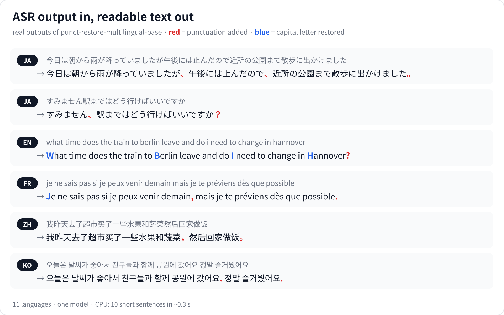

# punct-restore

Restore **punctuation and capital letters** in unpunctuated text such as speech-recognition (ASR) output.
11 languages with one model: Japanese, Chinese, Korean, English, German, French, Spanish, Italian, Portuguese, Dutch, Russian.



```bash
pip install punct-restore
punct-restore "what time does the train to berlin leave and do i need to change in hannover"
# What time does the train to Berlin leave, and do I need to change in Hannover?
```

```python
from punct_restore import PunctRestorer
pr = PunctRestorer()          # "small" (141M, default) or PunctRestorer("base") (308M)
pr("すみません駅まではどう行けばいいですか")
# 'すみません、駅まではどう行けばいいですか？'
```

- On Wikipedia text not used for training: average punctuation F1 **0.778 over 11 languages** (base); Japanese 0.78.
- Models and weights: MIT, on Hugging Face ([base](https://huggingface.co/kanameaijp/punct-restore-multilingual-base), [small](https://huggingface.co/kanameaijp/punct-restore-multilingual-small)).
- Benchmarks, limitations and training code: https://github.com/kanameai/punct-restore
- Not yet evaluated on real ASR transcripts.
