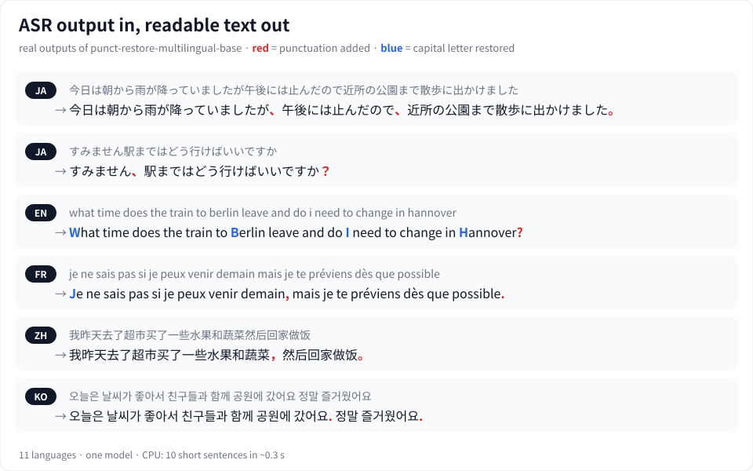
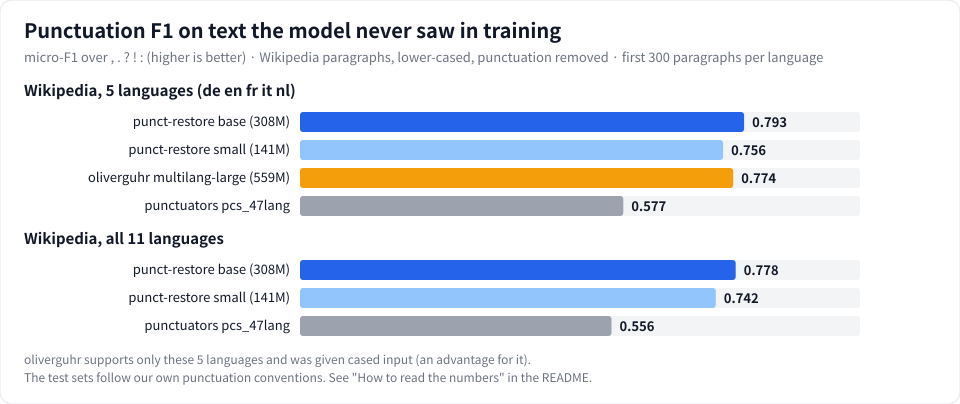
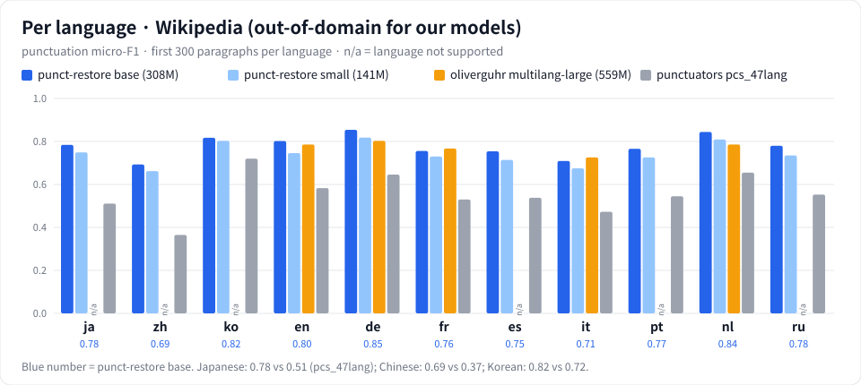
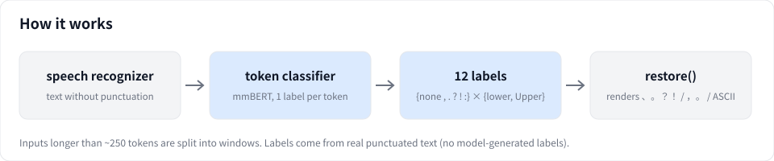

<div align="center">

# punct-restore

**音声認識の出力に、句読点と大文字を戻す。11 言語に 1 つの小さなモデルで対応。**

[-blue)](https://huggingface.co/kanameaijp/punct-restore-multilingual-base)
[-93c5fd)](https://huggingface.co/kanameaijp/punct-restore-multilingual-small)
[](LICENSE)

[すぐ試す](#すぐ試す) · [ほかのモデルとの比較](#ほかのモデルとの比較) · [モデル](#モデル) · [できないこと](#できないこと) · [English](README.md)



</div>

## 特長

- **日本語・中国語・韓国語に対応。** `、。？！` も戻せます。日本語の Wikipedia の文で、47 言語対応のモデル（pcs_47lang）が F1 0.51 のところ、**0.78**。
- **学習に使っていない文でも強い。** Wikipedia（学習データに含めていない）で、11 言語の平均 **0.778**。pcs_47lang より **22 ポイント高く**、よく使われている oliverguhr のモデルとは、対応する 5 言語でほぼ同等（0.793 と 0.774）。大きさは**約半分**です。
- **大文字も戻す。** 句読点と同時に、語頭を大文字にするかも当てます（`berlin` → `Berlin`）。
- **小さくて速い。** 141M / 308M パラメータ。`transformers` だけで動き、CPU で短い文 10 個を約 0.3 秒。
- **ライセンスがきれい。** 重みもコードも MIT。学習データは青空文庫（パブリックドメイン）と Tatoeba（CC BY 2.0 FR）だけ。Wikipedia も、閉じたモデルの出力も使っていません。

## すぐ試す

```bash
pip install punct-restore
punct-restore "すみません駅まではどう行けばいいですか"
# すみません、駅まではどう行けばいいですか？
```

```python
from punct_restore import PunctRestorer
pr = PunctRestorer()          # small（既定）。精度優先なら PunctRestorer("base")
pr("今日は朝から雨が降っていましたが午後には止んだので公園まで散歩に出かけました")
# '今日は朝から雨が降っていましたが、午後には止んだので、公園まで散歩に出かけました。'
```

文字起こしのファイルは 1 行ずつ処理できます: `cat transcript.txt | punct-restore -m base`

使いみち: Whisper などの文字起こしの整形、字幕、議事録、ボイスメモ。

## ほかのモデルとの比較





<details>
<summary><b>数字の読み方</b>（引用する前に読んでください）</summary>

- 指標: `, . ? ! :` の位置と種類が両方合っているかの micro-F1。
- 入力: 各テストの最初の 300 段落を、小文字にして句読点を消したもの。上の図はすべて **Wikipedia**（公開モデルの学習には使っていない）。
- 比べた相手: oliverguhr/fullstop-punctuation-multilang-large（MIT、英独仏伊蘭の 5 言語のみ、`!` と大文字は出さない。大文字入りの文を渡したので相手に有利）と punctuators の pcs_47lang（Apache-2.0）。どちらも私たちの句読点の付け方に合わせて学習したものではないので、差の一部は「流儀の違い」です。
- **実際の音声認識の出力ではまだ測っていません。** 聞き間違いやフィラーがあると、どのモデルも数字は下がります。
- 細かい表（クラス別、学習データに近いテスト）はモデルカードにあります。

</details>

## モデル

| モデル | パラメータ | 大きさ | Wikipedia F1（11 言語） | 向いている場面 |
|---|---|---|---|---|
| [base](https://huggingface.co/kanameaijp/punct-restore-multilingual-base) | 308M | 1.2 GB | **0.778** | 精度を優先 |
| [small](https://huggingface.co/kanameaijp/punct-restore-multilingual-small) | 141M | 0.5 GB | 0.742 | CPU・メモリが少ない環境 |

## しくみ



mmBERT（MIT）を元に、トークンごとに「後ろに付く句読点」と「語頭が大文字か」を当てる分類器として学習しました。正解は元の文の句読点そのものです。

## できないこと

- 実際の文字起こしでの評価はまだ。
- かぎかっこ・括弧・三点リーダーは戻せません。`！` と `：` は苦手。
- 略語は頭の 1 文字だけ大文字（`NASA` → `Nasa`）。
- 日本語の読点の位置は好みが分かれます。学習データの付け方に寄ります。

再現の手順・データとライセンス・引用のしかたは [README.md](README.md) を見てください。
