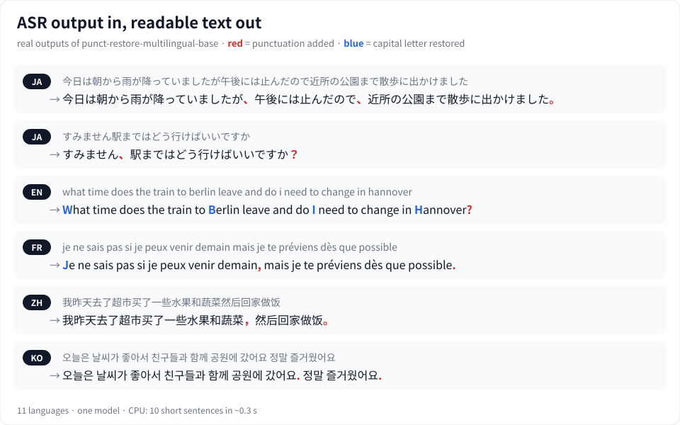
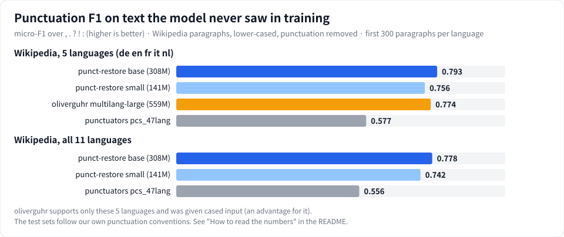
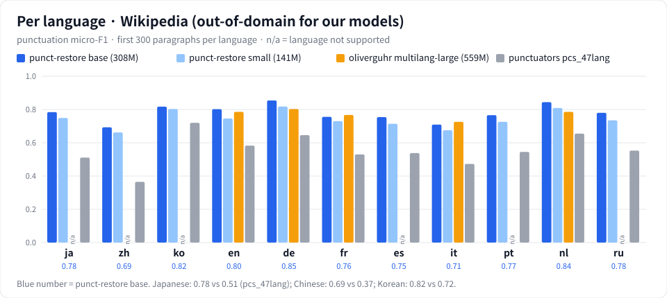
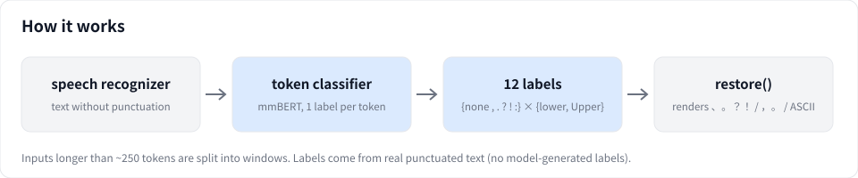

<div align="center">

# punct-restore

**Add punctuation and capital letters back to speech-recognition output — 11 languages, one small model.**

[-blue)](https://huggingface.co/kanameaijp/punct-restore-multilingual-base)
[-93c5fd)](https://huggingface.co/kanameaijp/punct-restore-multilingual-small)
[](LICENSE)


[Quick start](#quick-start) · [Benchmarks](#benchmarks) · [Models](#models) · [How it works](#how-it-works) · [Limitations](#limitations) · [日本語](README.ja.md)



</div>

## Why punct-restore

- **Japanese, Chinese and Korean included.** Restores `、。？！` / `，。？！` as well as European punctuation. On Japanese Wikipedia text it scores **0.78 F1 vs 0.51** for the 47-language baseline.
- **Strong on text it never saw.** On Wikipedia (not in our training data) the base model averages **0.778 F1 over 11 languages, +22 points** over `pcs_47lang`, and is on par with the popular `oliverguhr` model on its 5 languages (0.793 vs 0.774) at **about half the size**.
- **Capital letters too.** One pass predicts both the punctuation mark and whether the word starts upper-case (`berlin` → `Berlin`, `i` → `I`).
- **Small and fast.** 141M / 308M parameters, plain `transformers`, runs on CPU (10 short sentences in about 0.3 s).
- **Clean licenses.** Weights and code are MIT. Trained only on Aozora Bunko (public domain) and Tatoeba (CC BY 2.0 FR) — no Wikipedia, no outputs of closed models.

## Quick start

```bash
pip install torch transformers
git clone https://github.com/kanameai/punct-restore && cd punct-restore
python publish/punct_restore.py kanameaijp/punct-restore-multilingual-small "今日は朝から雨が降っていましたが午後には止んだので公園まで散歩に出かけました"
# 今日は朝から雨が降っていましたが、午後には止んだので、公園まで散歩に出かけました。
```

```python
from transformers import AutoModelForTokenClassification, AutoTokenizer
from punct_restore import restore   # publish/punct_restore.py (also in the model repos)

name = "kanameaijp/punct-restore-multilingual-small"
tok = AutoTokenizer.from_pretrained(name)
model = AutoModelForTokenClassification.from_pretrained(name).eval()
print(restore(model, tok, "what time does the train to berlin leave and do i need to change in hannover"))
# What time does the train to Berlin leave and do I need to change in Hannover?
```

Typical uses: cleaning up Whisper / other ASR transcripts, subtitles, meeting notes, voice memos, and text from tools that drop punctuation.

## Benchmarks





<details>
<summary><b>How to read the numbers</b> (please read before quoting them)</summary>

- Metric: character-position micro-F1 over `, . ? ! :` — a mark counts only if both the class and the position are right.
- Inputs: the first 300 paragraphs of each held-out test set, lower-cased with punctuation removed. Everything above is **Wikipedia**, which is **not** in the training data of the published models.
- Baselines: [`oliverguhr/fullstop-punctuation-multilang-large`](https://huggingface.co/oliverguhr/fullstop-punctuation-multilang-large) (MIT; en/de/fr/it/nl only; no `!`, no capitalization; it was given cased input, which helps it) and `punctuators` `pcs_47lang` (Apache-2.0; general 47-language model). Neither was tuned to our punctuation conventions, so the gap is partly a style difference.
- **Not yet measured on real ASR output.** Recognition errors and fillers will lower all scores.
- In-domain test sets (Aozora Bunko, Tatoeba) score higher (e.g. 0.96 on English Tatoeba) but favour our models; full tables, per-class scores and the in-domain comparison are in the model cards.

</details>

## Models

| model | params | size | Wikipedia F1 (11 langs) | use it when |
|---|---|---|---|---|
| [punct-restore-multilingual-base](https://huggingface.co/kanameaijp/punct-restore-multilingual-base) | 308M | 1.2 GB | **0.778** | best quality |
| [punct-restore-multilingual-small](https://huggingface.co/kanameaijp/punct-restore-multilingual-small) | 141M | 0.5 GB | 0.742 | CPU / low memory; about 1 point lower on short, spoken-style text |

Supported languages: Japanese, Chinese, Korean, English, German, French, Spanish, Italian, Portuguese, Dutch, Russian.

## How it works



Fine-tuned from [mmBERT](https://huggingface.co/jhu-clsp/mmBERT-base) (MIT) as a token classifier. Each token gets one of 12 labels = {none, comma, period, question, exclamation, colon/semicolon} × {lower, upper-case word start}.
Training text has its punctuation removed and is lower-cased automatically; the original text is the target. 25% of paragraphs are cut into fragments so the model also handles text that starts or ends mid-sentence. Details: `gpu/punct/common.py`.

## Limitations

- No evaluation on real speech transcripts yet (recognition errors, fillers, spoken Japanese without clear sentence ends).
- No quotes, brackets, ellipses or Spanish `¿ ¡`. `!` and `:` are weak (F1 0.41 / 0.22).
- Acronyms get only the first letter capitalized (`NASA` → `Nasa`, `GPU` → `Gpu`).
- Japanese comma placement is partly a matter of style; the model follows its training data.
- Do not use for legal or medical transcripts without human review.

## Reproducing the published models

The scripts are the job files we ran, in numeric order, on one RTX A6000 (48 GB). Copy `gpu/` to `~/horizon/` on a machine with an NVIDIA GPU (CUDA 12) and run:

```bash
cd ~/horizon
bash queue/000_env.sh            # venv + torch (cu126) + pinned libraries (requirements.txt)
bash queue/001_data.sh           # Wikipedia (test sets only for the published models) + Aozora Bunko
bash queue/010_tatoeba_full.sh   # Tatoeba sentences (CC BY 2.0 FR)
bash queue/018_prep4.sh          # split by article/work/sentence group; writes data/proc/train_nowiki.jsonl
bash queue/019_train_base_nowiki.sh    # ~1.4 h
bash queue/021_train_small_nowiki.sh   # ~45 min
bash queue/022_eval_nowiki.sh    # evaluation + demo check
```

The other jobs (002–017) are the experiments that led here: a first model with Wikipedia (`013`, `014`), baselines (`015`, `016`), diagnostics.
The data and license record is in `NOTES/data_licenses.md`. Seeds are fixed, but GPU non-determinism means numbers can differ slightly.
The figures in this README are generated by `python docs/make_figures.py` from the numbers in the model cards.

## Data and licenses

| source | license |
|---|---|
| Aozora Bunko, cleaned ([globis-university/aozorabunko-clean](https://huggingface.co/datasets/globis-university/aozorabunko-clean)) | CC BY 4.0 (texts are public domain) |
| [Tatoeba](https://tatoeba.org/en/downloads) sentences | CC BY 2.0 FR — © Tatoeba contributors |
| Wikipedia (`wikimedia/wikipedia`) — test sets and optional `-wiki` experiments only | CC BY-SA 3.0 / GFDL |

Base model mmBERT: MIT, © JHU-CLSP. Model weights and this repository's code: MIT.

## Contributing

Issues and pull requests are welcome. Most useful right now: **evaluation on real ASR transcripts** (any language), examples where the output is wrong, and support for more punctuation marks.

## Citation

```bibtex
@misc{punctrestore2026,
  title  = {punct-restore: multilingual punctuation and capitalization restoration},
  author = {kanameai},
  year   = {2026},
  url    = {https://github.com/kanameai/punct-restore}
}
```
